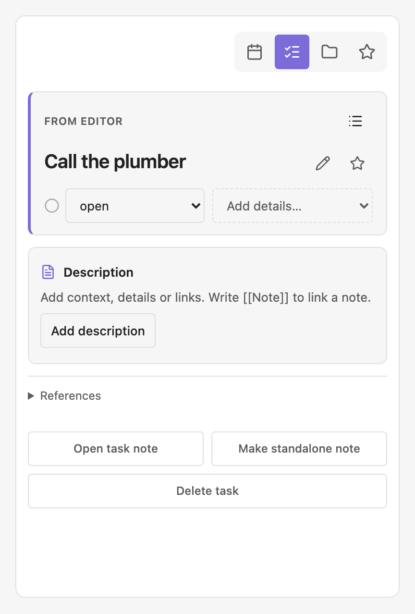
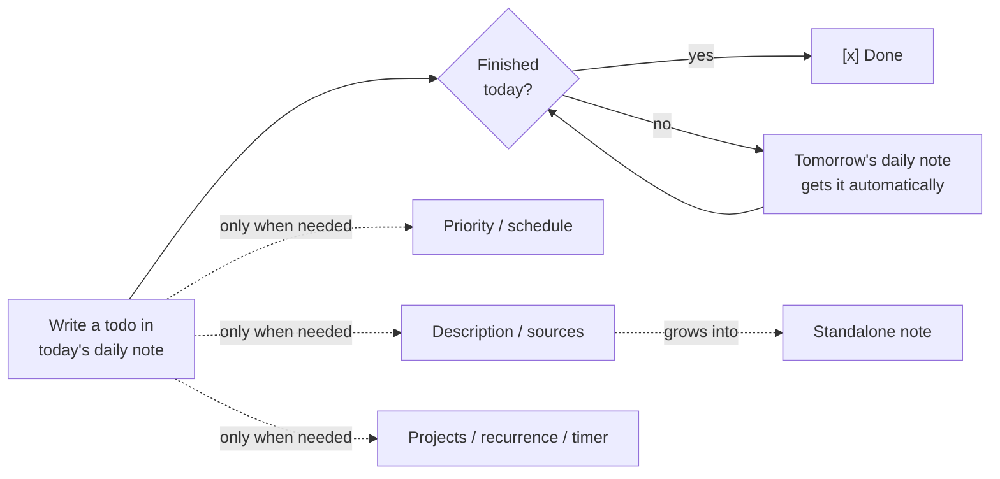
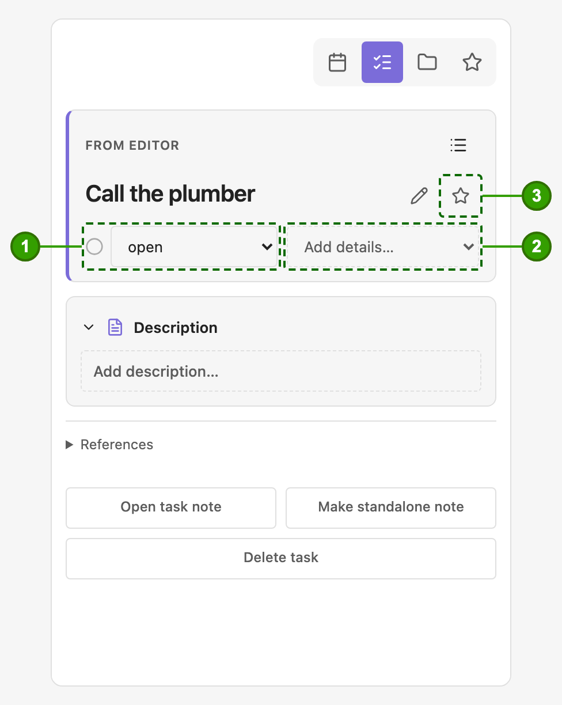
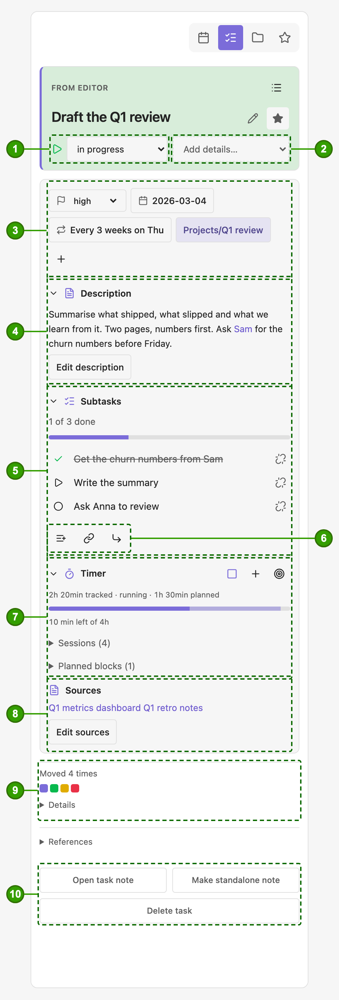
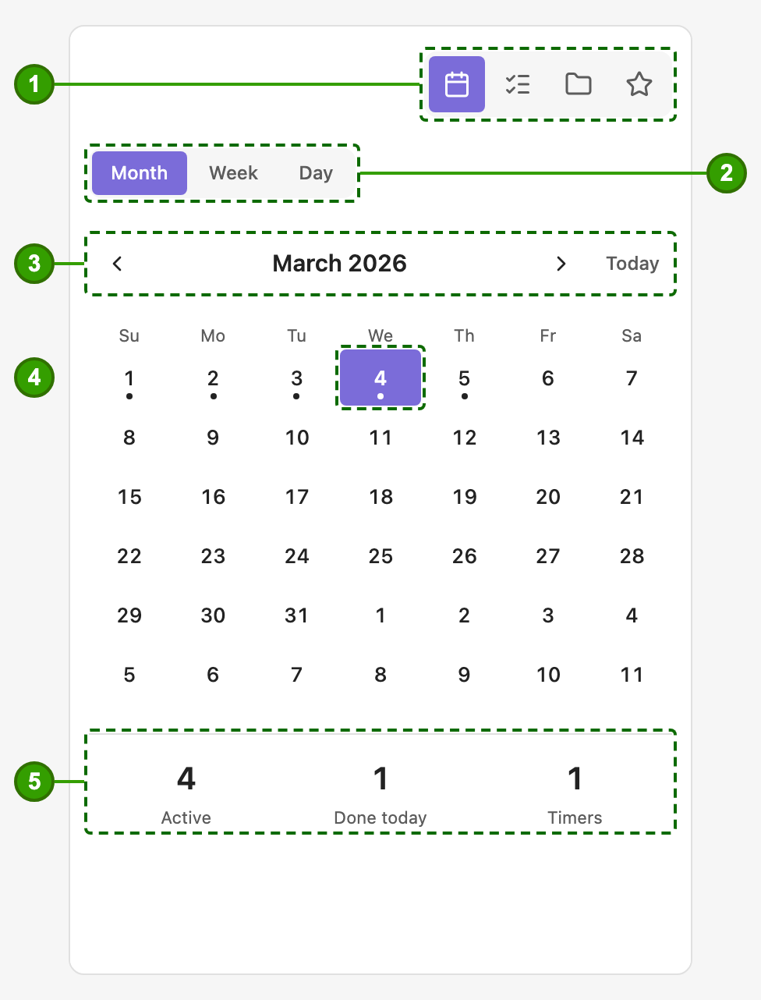
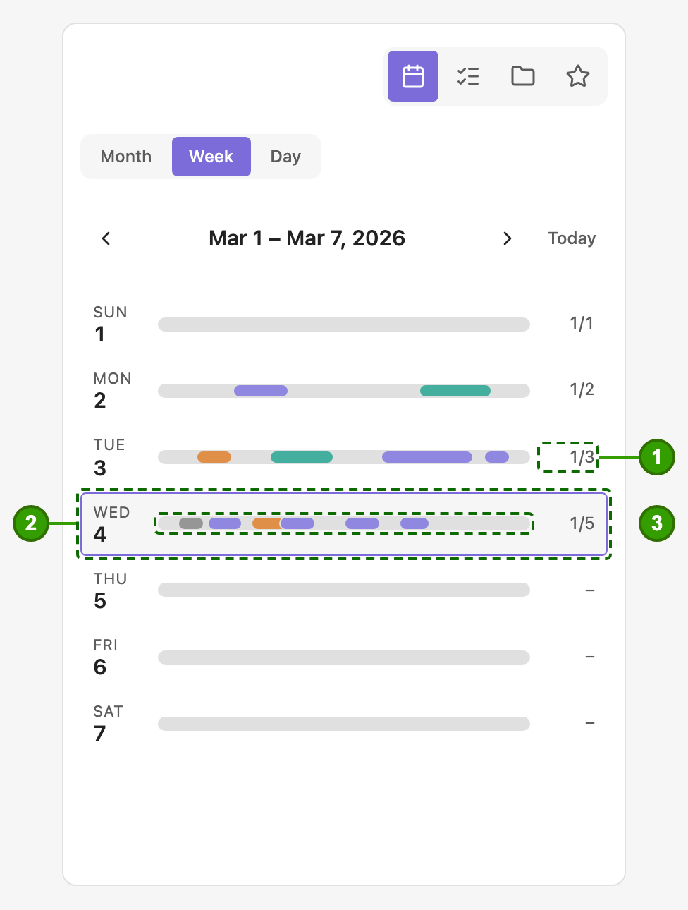
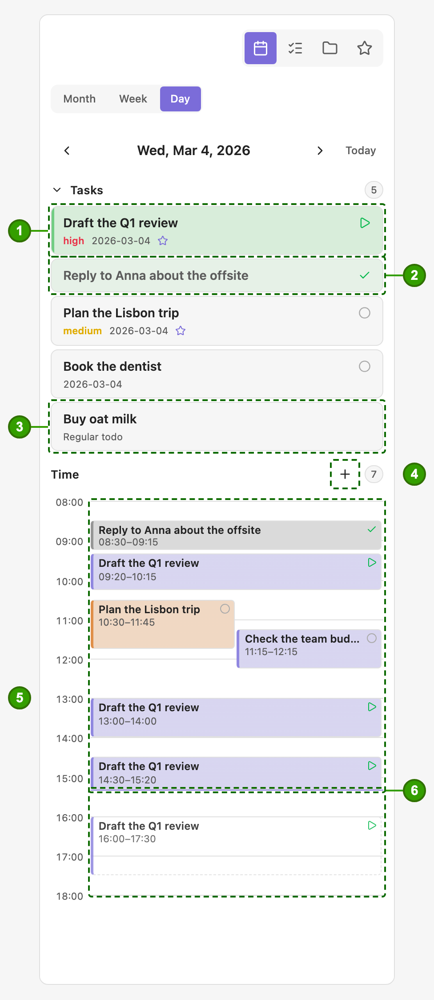
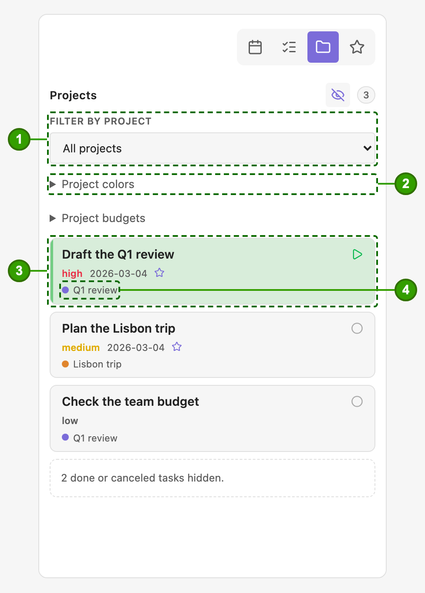
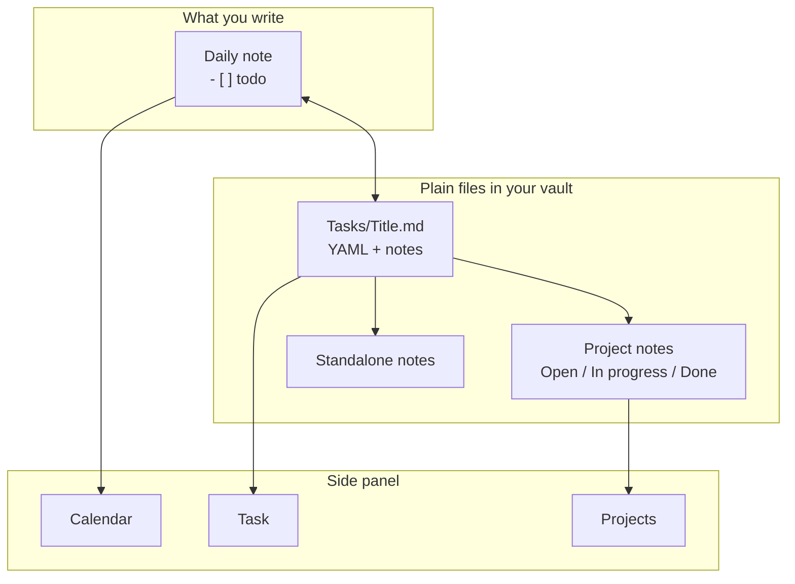

# Organized

**Your daily note stays your daily note. Organized gives its todos a memory.**

Many of us run our day from a daily note: a few checkboxes, some notes, done. That works until a todo needs more than a checkbox: it is unfinished and should show up again tomorrow, it matters more than the rest, it belongs to a project, it needs a deadline, a few notes, or a timer. Organized adds exactly that, without moving your work out of Markdown. No service, telemetry or proprietary task database.

## See it

The side panel, rendered from the plugin's own code and styles with sample data (light or dark, following your GitHub theme).

<table><tr><td align="center" valign="top"><picture><source media="(prefers-color-scheme: dark)" srcset="resources/screenshots/day-dark.png"></picture><br><sub>Day</sub></td><td align="center" valign="top"><picture><source media="(prefers-color-scheme: dark)" srcset="resources/screenshots/week-dark.png"></picture><br><sub>Week</sub></td><td align="center" valign="top"><picture><source media="(prefers-color-scheme: dark)" srcset="resources/screenshots/month-dark.png"></picture><br><sub>Month</sub></td></tr></table>

<table><tr><td align="center" valign="top"><picture><source media="(prefers-color-scheme: dark)" srcset="resources/screenshots/task-minimal-dark.png"></picture><br><sub>Task, nothing added</sub></td><td align="center" valign="top"><picture><source media="(prefers-color-scheme: dark)" srcset="resources/screenshots/task-dark.png"></picture><br><sub>Task, everything added</sub></td><td align="center" valign="top"><picture><source media="(prefers-color-scheme: dark)" srcset="resources/screenshots/projects-dark.png"></picture><br><sub>Projects</sub></td></tr></table>

## Why another plugin?

There are excellent calendar plugins and excellent task plugins. Organized is neither a calendar you plan in nor a database you query. It is built around one habit: **you run your day from a daily note**, and the todos in it should not be forgotten, lost or turned into something else.

- **Most task plugins make your todo an item in their system.** Special syntax, query blocks, dashboards. Organized leaves your `- [ ]` line exactly as it is and adds a *memory* behind it: when it was scheduled, how many days it was carried over, how long you worked on it, which project it belongs to.
- **Most calendar plugins show your notes by date.** Organized shows what you did: a week of bars and a day of time blocks drawn from the timers you actually ran, coloured by project.
- **Procrastination becomes visible.** A todo you keep carrying over shows it, in a strip of small squares that turn from green to red against *your own* habits, not a fixed rule.
- **Nothing to adopt.** Open today's daily note and yesterday's open todos are already there. Everything else is opt-in, one todo at a time.

Organized is **not** a query language, a kanban board or a dashboard builder. If you live in those, a dedicated task plugin is the better home for your todos, and Organized can sit next to it. If you only wish your daily note remembered what you did not finish, this is for you.

## Why use it

- **Unfinished work follows you.** Open today's daily note and yesterday's open todos are already there. Nothing is copied by hand and nothing silently disappears.
- **A todo can grow when it needs to.** Priority, a scheduled date, a description (write `[[Note]]` in it to link any note), sources, a recurrence, projects, tracked time: each one is added only when you ask for it.
- **It is still your Markdown.** A todo is a normal `- [ ]` line in a normal note. The details live in a plain note file, so search, links, sync and backups work as they always did.
- **Keyboard first.** Type a letter in the checkbox (`[!]`, `[<]`, `[/]` ...) and the todo does that. No menus required.

## Use as little or as much as you like

Organized does not ask you to adopt a system. Stay at the first level forever, or grow into the next one on the day you need it.

| Level | What you do | What you get |
|---|---|---|
| **1. Forwarder** | Write todos in your daily note as usual. Change nothing else. | Unfinished tasks carry over to the next day automatically; the old line is marked as forwarded so history stays honest. |
| **2. Organised** | Press `[!]` for priority, `[<]` to schedule for a date, `[*]` to favourite. | The daily note sorts by priority and keeps what you are working on at the top; scheduled tasks arrive on their day. |
| **3. Full workflow** | Add a description and sources, attach projects, repeat tasks, start a timer, break a todo into subtasks by indenting, turn a todo into a standalone note. | A calendar with the time you really spent, project pages with Open / In progress / Done, recurring routines, and notes that came from todos. |



## A tour of the side panel

The side panel is where a todo's memory is shown. The green numbers on each picture match the lists below them; the pictures are rendered from the plugin's own code and styles with sample data, so they are regenerated rather than re-captured when the interface changes.

### Start in the daily note

You do not need the panel to use Organized. Put a letter between the brackets of a todo and it does that thing, then the checkbox goes back to normal:

| Type | What happens |
|---|---|
| `[!]` | Choose a priority |
| `[<]` | Schedule it for a date (or clear the date) |
| `[/]` | Start a timer; its time is recorded |
| `[t]` | Add time: worked or planned, by its times |
| `[*]` | Favourite it |
| `[j]` | Link it to projects |
| `[n]` | Turn it into a standalone note |

Almost everything the panel does to a todo has a letter (the [full list](#marker-reference) is further down). The panel is there for the whole picture, never as a place you are forced to work in.

### Simple on purpose: a task with nothing added



- **1** · **Status**: open, in progress, completed or canceled. In progress records the time.
- **2** · **Add details…**: priority, schedule, timer, recurrence, projects, subtasks, description, sources. Each appears only when you ask for it.
- **3** · **Favourite**: the star, in case this is one to keep close.

That is all a todo costs until it needs more: a title and a status. No empty form with twenty fields; the panel shows only what you chose to use. If this is all you ever want, [stay here](#use-as-little-or-as-much-as-you-like).

### The same task when you used everything



- **1** · **Status**, and **2** · **Add details…**: the same two controls as above.
- **3** · **Priority**, **Schedule** (pick a date, or clear it again; scheduled tasks arrive in that day's note), **Recurring** and the task's **Projects** sit together as small pills in one wrapping row, above the description. A project pill takes its faint project colour, is cut short when the name is long, and opens the project note when tapped; the folder button links more projects.
- **4** · **Description** is the text of the task note itself. Description, Subtasks and Timer fold away with their chevron; the choice is remembered for every task, and a folded card keeps a one-line summary. Write `[[Note]]` in it to link any note.
- **5** · **Subtasks** with their progress. Indent a todo under another in your note (Tab) and it becomes a subtask; completing, canceling or forwarding the parent takes the open ones along.
- **6** · Three buttons to **add a subtask**, **link an existing task** or **make this a subtask of another**. Each row has a small unlink button.
- **7** · **Timer**: a line with the time worked and, when you have planned some, the time set aside, and three small icon buttons: start or stop the timer, add time by hand (past blocks are worked, future ones planned), and set a budget. Below: the budget bars and lists of sessions and planned blocks you can correct.
- **8** · **Sources**: links and notes it came from.
- **9** · **Moves**: one small square per time the task was scheduled or carried over. Squares turn from green to red against how often *you* usually carry things over (per project, once a project has enough tasks), and take your accent colour when you picked the date yourself. Hover a square, or open *Details*, to see each move.
- **10** · **Open task note**, **Make standalone note**, **Delete task**.

### Calendar: month, week and day



- **1** · The four tabs: **Calendar**, **Task**, **Projects**, **Favorites** (a star).
- **2** · Switch between **Month**, **Week** and **Day**.
- **3** · Move by month, or jump to **Today**.
- **4** · A dot marks a day that has a daily note. Selecting a day opens (or creates) its note; merely browsing months creates nothing.
- **5** · What is **Active**, what you finished **today** and how many **Timers** are running.



- **1** · Done out of total tasks for the day.
- **2** · A row per day; tap it to open that day.
- **3** · The bars are the time tasks were in progress, in the colour of their project.



- **1** · A task of the day with its status, priority, date, star and project.
- **2** · Finished tasks stay in the list, marked done.
- **3** · A plain, unlinked todo from the daily note is listed too; it is labelled *Regular todo*.
- **4** · **Add time worked** by hand, or tap any block to correct it. Tap an empty spot on the grid to plan an hour there; planned blocks have a dashed outline and can be anywhere, including days ahead. A planned block that is over can be logged as worked.
- **5** · The time grid: a block for each stretch of work, overlapping blocks side by side.
- **6** · The line for **now**.

### Projects



- **1** · Filter the tasks by project.
- **2** · Give each project a colour; it follows the task everywhere (the week bars, the day blocks, the chips).
- **3** · A task card with status, priority, date and star.
- **4** · The project chip, in the project's colour; it opens the project note.

#### Project time budgets

A project can have time budgets, all optional, kept as hours in the project note's properties (**Projects** tab → *Project budgets* edits them, or write them yourself):

```yaml
organized_budget: 120          # the whole project
organized_budget_daily: 2
organized_budget_weekly: 10
organized_budget_monthly: 30
```

Every task linked to the project then shows one slim bar per budget you set, in its Timer card (which appears by itself): the tracked time of **all** the project's tasks today, this week (by your Obsidian week start), this month or in total, with planned time lighter and any overrun in red. A task in several projects counts in full toward each of them (nothing is split). A project without budgets shows nothing. Time logged before sessions had dates counts only toward the whole-project budget.

#### Using projects

A project is an ordinary note that Organized has been told is a project. To attach one to a todo:

1. Change the checkbox to `[j]` (`- [j] Plan the launch`). A picker opens with your projects.
2. Tick one or more and press **Save links**. The checkbox goes back to its normal state, and the project shows on the todo and in the **Projects** tab.

Writing `[[Launch]]` in the todo's text does not do this: that is an ordinary link and nothing more. To use a note you already have as a project, add one property to it (in Obsidian's Properties view, or at the top of the file):

```yaml
---
organized_type: project
---
```

The value must be exactly `project`. The picker lists only notes that have it, so a note without the property is not shown. If you type the name of such a note into the picker's search box, you are offered *(create)* and a new note is made in the `Projects/` folder inside your task folder, so add the property to your own note first and it appears in the list. Notes made from the picker already have the property, plus **Open / In progress / Ongoing / Done** headings that linked tasks move between as their status changes.

## How it fits Obsidian

Obsidian's strength is that your notes are plain files you own. Organized is built to leave that intact.

- **Files over apps.** Every task is a Markdown note named after its todo (`Tasks/Write the Q1 report.md`) with standard YAML. Uninstall the plugin and you keep every task, readable in any editor.
- **Daily notes are the home base.** Organized works with your existing daily-note setup, folder, filename format and template. It does not replace them or hide them behind its own screen.
- **Links, not silos.** A todo can become a note, belong to project notes, and cite sources, all with ordinary wiki links and properties that Search, Graph, Bases and other plugins can use.
- **Local and quiet.** No account, no server, no tracking. It runs on desktop and mobile.
- **Composable.** Organized adds behaviour to the Markdown you already write; it does not ask you to leave it.



## First run

The first time Organized starts on a fresh install it shows a short **onboarding card**: twelve steps with small illustrations: the two settings to make first, the idea behind the plugin, the side panel and calendar, showing task properties in the note, the checkbox letters, pressing and holding on a phone, jumping into a checkbox from the keyboard, and how to start and leave. Skip it whenever you like; it appears once. Reopen it with the command **Organized: Show onboarding card** or the **Onboarding card** button in **Settings → Organized → Help**.

After an update, Organized shows a short **What's new** note once, instead of the tour (a fresh install never sees it). Reopen the notes for your version with **Organized: Show what's new**, or switch them off with **Show what's new after updates** under **Settings → Organized → Help**.

## Leaving Organized

Organized never locks your notes in. A task note already reads naturally without the plugin (properties, then the description as plain text, then your sources), and the only thing Organized adds to a todo is a hidden HTML comment holding the task's id. When you want to leave, or just tidy up finished tasks, run **Organized: Retire tasks…** (also under **Settings → Organized → Help**). It opens a window; nothing changes until you press **Retire**, the old text is saved under `note-backups` in the plugin folder first, and **Undo** restores the notes and their names. Run it on one device and let sync settle.

| Choice | Options |
|---|---|
| **Which tasks** | Only completed or canceled tasks older than N days (what the automatic cleanup does), or all tasks. |
| **Todos in your notes become** | A plain todo (title only), or a link to the task note (`- [ ] [[Plan release]]`, marker kept; the link style follows your Obsidian setting). |
| **Task notes** | Keep where they are, rename to the todo title (notes created by recent versions already carry it; only notes still named after an id are renamed), or move to Obsidian's trash. |
| **Properties of task notes** | Keep all, or remove Organized's properties and keep only the title (as the file name) and the text. Properties you added yourself (tags, aliases…) are never removed. |
| **Kept under the todo** | When a task note is removed or stripped, what stays in your daily note as a quote under the todo: nothing, the description, or description, sources and time worked. |

Combinations that cannot work are switched for you (removing properties needs the rename; a trashed note cannot be linked to) and a line at the bottom says exactly what will happen. Choosing the trash or removing properties asks once more; a run that trashes notes offers no Undo (restore them from Obsidian's trash). A task that cannot be retired (for example a note that changed while the window was open) is left exactly as it was and reported. **Convert tasks in this note back to todos** does the plain, keep-everything version for one note.

What the window never touches: project notes (their `organized_type`, `organized_start` and `organized_color` properties and the Open / In progress / Ongoing / Done headings) and lines such as `Worked 2026-03-02: 09:00–09:30` under a checkbox, and `[>]` or `[<]` markers. They are ordinary Markdown you can keep or delete.

## Install

**Organized is in the process of being registered as an official Obsidian community plugin.** Until that is approved it does not appear under *Settings → Community plugins → Browse*, so install it by hand:

- **With BRAT** (recommended; it also keeps the plugin up to date): in the BRAT plugin choose *Add Beta Plugin*, enter **`davadev/Organized`** and pick the latest release.
- **Manually:** download `main.js`, `manifest.json` and `styles.css` from the [latest release](https://github.com/davadev/Organized/releases/latest) into the `.obsidian/plugins/organized/` folder of your vault, restart Obsidian and enable *Organized* under *Settings → Community plugins*.

Try it in a **test vault** first if you like; your notes stay plain Markdown either way.

Open **Settings → Organized** and match **Daily-note folder** and **Filename format** to your daily-note setup. Core configuration is not read through undocumented APIs. Set **Daily-note template** to a note such as `Templates/Daily.md` so daily notes Organized creates (for example when scheduling to a new date) start from it; `{{date}}`, `{{date:FORMAT}}` and `{{title}}` are filled in. Task files default to `Tasks/` (visible Markdown, not a hidden `.tasks` directory).

**Planned time** is never counted as worked: it lives in its own list on the task. With *Start tasks at their planned time* on (off by default, under Task behavior), while Obsidian is open a task is set in progress when its planned block begins and put back to open when the block ends, with a notice to adjust the time. No timer is started, and a status you set yourself (done, canceled, or a running timer) is never changed. Recurring tasks are not started this way.

**Auto-forward is on by default.** Opening today's daily note carries the latest unfinished non-recurring tasks forward, updates their schedule and marks prior occurrences forwarded; it does not create today's note on a timer. Recurring `[f]` occurrences are skipped because recurrence creates their next daily-note occurrence. Turn auto-forward off in settings if unwanted. A formatted batch summary offers Undo. **Show scheduled date link** controls date links globally and is on by default.

Open the ribbon calendar or run **Organized: Open inspector**. Its tabs, shown as icons at the top right, are Calendar, Task, Projects and Favorites (a star). Selecting a day in the month view explicitly opens/creates its daily note. The **Week** and **Day** views show tasks and the time they were In Progress (recorded from the moment you update); they never create notes. Merely browsing months creates nothing. Time worked can be added or corrected by hand: the **+** beside the Day view's Time heading, a tap on a block, or the Task tab's Timer card, whose foldable Sessions list shows every session newest first by day.

Task notes written by older betas were named after an id; one automatic step, once after updating, renames them after their todo (a backup of the plan is saved in the plugin folder and the notice has Undo). Update Organized on all your devices at the same time, because an older version looks for task notes by their id. The command **Rename task notes to their titles** runs it again.

The Task tab keeps your selection while you scroll or edit the sidebar. When the cursor is not on a task, it lists task lines from the current note; tap a linked task to jump the editor cursor there and show its details. Optional cards show populated details or the section you request with a shortcut or **Add details…**; history and references are collapsed. Editing the title or any task note section happens inline in the sidebar, with Save and Cancel above the field so the mobile keyboard cannot cover them. **Description** is the text of the task note itself, so write `[[Note]]` in it to link any note; it shows as a clickable link when you are not editing. **Sources** (external links and `[[notes]]`) sit below it. Task notes from older versions (with `## Description`, `## Notes`, `## Idea` headings) are rewritten once after updating, with a backup and an Undo button, so the description becomes the plain text of the note. The Projects tab is grouped into Favorites, Projects and Canceled cards with a project filter and counts. Use **Delete task** on the Task tab to confirm removal of the canonical note and all linked occurrences. Fully restart Obsidian after updating to refresh the setting groups.

## Link or create tasks

Typing a new `- [ ] ` or inserting one with Obsidian's mobile checkbox toolbar opens the native task picker. Choose an existing unfinished task (completed and canceled ones are not listed), **Create new task**, or **Keep as regular todo**. The last option closes the picker and leaves an ordinary unlinked checkbox. Pasted task blocks are not converted automatically. Use **Attach/create task** on an existing checkbox; **Duplicate as new task** creates an independent ID. Missing links are never silently replaced. Markdown links in task titles and task-note sections open from the picker and inspector; title editing keeps the raw Markdown syntax.

Run **Organized: Convert unchecked todos to tasks** on a regular note to convert its ordinary unchecked todos into canonical tasks. It confirms first, skips linked, completed, in-progress and empty items, and preserves indentation and line endings. To leave Organized, see [Leaving Organized](#leaving-organized): **Organized: Retire tasks…** turns tasks back into ordinary Markdown with options, and **Convert tasks in this note back to todos** does the simple version for one note.

Each canonical task is a note in `Tasks/` named after its todo (`Write the Q1 report.md`; a counter is added when a name is taken, and names are unique across the vault so `[[links]]` stay unambiguous), identified by the `id` in its properties, never by its file name, so renaming the note by hand is safe. It has its properties in standard YAML and the description as the note text, followed by an optional `## Sources` heading, so the note reads naturally even without the plugin. Each occurrence carries a hidden HTML comment with the task's id. A copied ID remains the same task. Selected properties render read-only in Reading/Live Preview; no generated dates/properties are written into occurrence source. The inspector edits the canonical note.

**Subtasks.** Indent a linked todo under another todo (Tab, as in any Obsidian list) and it becomes that todo's subtask: the same picker asks which task it is, and the parent's task note lists it in its properties as a link (`subtasks: ["[[Buy milk]]"]`), so the relation reads naturally even without the plugin. The nesting in the note is the truth: indenting, outdenting, moving or deleting a todo line updates the lists a moment after you stop typing, and **Organized: Repair subtask links in this note** redoes it for a note edited somewhere Organized was not running. **Organized: Add subtask** (or the `[+]` marker) inserts an empty indented todo under the one at the cursor. Turn on **Subtask progress** under Rendered task properties to see `2/3` beside a parent (gray at none, accent partway, green when all are done; canceled subtasks are not counted); the Task tab shows a **Subtasks** card with the same progress, a toggle per subtask, **Add subtask**, a *Part of* link from a subtask back to its parent, and a row of small icon buttons (add a subtask, **Link existing task…**, **Make subtask of…** or **Remove from parent**) that record the relation in the properties and indent the todo under its parent in every note that has both (a notice offers Undo). The command **Indent subtasks under their parents** does the same for every relation that was made before, once automatically after updating. Organized indents with what Obsidian's Tab key writes (a tab, or the spaces of your *Indent* setting when *Use tabs* is off). Completing a parent completes its subtasks that are still open or in progress, and canceling it cancels them; done and canceled subtasks are never changed, reopening a parent changes nothing, and a notice with **Undo** names what changed. When the last open subtask is done nothing happens to the parent, but its progress turns green and the Task tab offers **Complete parent**. Forwarding or scheduling a parent (the `[>]` and `[<]` markers, the panel, and the automatic carry-over to today) takes the subtasks that are still open or in progress along, indented under it in the new note; done and canceled ones stay behind as the record. A subtask moved on its own goes under its parent when the new note has it. Sorting keeps subtasks among their own siblings. Recurring tasks cannot be parents or subtasks. A todo nested under a plain todo, or typed as **Keep as regular todo**, is not a subtask.

In **Settings → Task storage**, **Keep completed tasks (days)** optionally sets retention from the date a task is completed or canceled. It defaults to `0` (disabled). When enabled, cleanup runs while opening today's daily note: linked checkboxes are unlinked and the canonical task files move to Obsidian's trash. Open/in-progress, recurring, and legacy completed tasks without a recorded completion date are preserved. Keep a vault backup and confirm Obsidian's trash preference before enabling automatic cleanup.

**What retired tasks keep** chooses what the checkbox leaves behind: *the title only* (default), *add description* (the description as a quote under the checkbox) or *add everything* (also sources, plus one line per day of time worked, such as `- Worked 2026-03-02: 09:00–09:30, 10:00–10:20 (50 min)`). It is written under the latest daily note only and reads as ordinary nested list items. The Day and Week views read those `Worked` lines back, so time blocks of retired tasks stay on the calendar; only the daily notes of the viewed days and the following month are read, and each is read once until it changes.

**Rendered properties are compact symbols** (Settings → Organized → Rendered task properties, where *Alignment* puts them right after the text or at the right edge of the line), each with a screen-reader label: a yellow star when starred (gray when not), a green repeat sign when recurring (gray when not), a flag coloured by priority, a status icon, a timer with the time (`45 min`, `1h 13min`; green while running), the created date and the number of moves. Project links show the project name only, in the project's colour, and open the project note. With sorting on, open todos come first (in-progress on top, then by priority, none included), followed by done, canceled, forwarded and scheduled ones; a plain bullet between todos (such as the link a todo leaves after becoming a note) does not split the list.

Identity and recurrence comments stay hidden in Live Preview, including the line being edited. Switch to source mode to inspect the original Markdown.

<a id="marker-reference"></a>

| Marker | Action |
|---|---|
| `[<]` | Choose schedule date; keep origin marker, link daily destination. Open subtasks travel with it. On a scheduled task the dialog also has **Clear date**: the date goes, the todo reopens where it was and the copy on the scheduled day is removed |
| `[>]` | Forward to tomorrow; daily origin stays gray, undated origin stays active. Open subtasks travel with it |
| `[/]` | Start durable wall-clock timer; complete or clear to stop/log. Changing the `/` to anything else, or deleting the line, stops the timer too and a notice says so |
| `[!]` | High/medium/low/none priority, constrained sort, then clear |
| `[a]` | Open the Description section for inline editing (autosaves), then clear |
| `[x]`, `[ ]` | Complete/reopen; stop active timer idempotently. Completing also completes the todo's open [subtasks](#link-or-create-tasks) |
| `[-]` | Reversible cancellation; recurring dates cancel independently. Also cancels open subtasks |
| `[*]` | Toggle favorite |
| `[s]` | Open the Sources section for inline Markdown references (URLs/Obsidian links, optional labels/citations) |
| `[j]` | Multi-select project notes; missing selected notes are created in the `Projects/` folder inside the task folder with `organized_type: project` and an `organized_start` date in their frontmatter and **Open / In progress / Ongoing / Done** headings that linked tasks move between as their status changes, and only such notes are listed. A project can have a colour (`organized_color: "#rrggbb"`, set from the Projects tab) shown as a dot beside its name on task cards and as the fill of its blocks in the calendar |
| `[n]` | Make a standalone note: asks for a folder, optional tags and an optional template, creates a note titled after the todo holding its description (then sources), and replaces the todo with a link to it. If a note of that name exists you can number the new one or link the existing one. The task's other copies are removed and its task note moves to Obsidian's trash. Also on the Task tab as **Make standalone note** Tracked time is kept: a running timer is logged, and a task with tracked sessions keeps a hidden task note so the calendar still shows (and links to) its time. |
| `[t]` | Add time (a block that has ended is saved as time worked, one still to come as planned time): asks for a start and an end (on the day of the daily note, 9:00–10:00 to begin with), logs the block on the task and the calendar, then restores the todo's own marker. Cancel leaves the `[t]` |
| `[+]` | Add a subtask: puts the todo's own marker back, inserts an empty indented todo under it (after its existing subtasks) and asks which task it is, like **Organized: Add subtask**. Needs the note open in the editor, so it is not offered in Reading view |
| `[r]` | Toggle recurrence in existing/current/future and subsequently created daily notes; clear after success |

**On a phone or tablet**, you do not need the keyboard for these: in a daily note, press and hold a todo's checkbox and a menu lists the markers above that act (not the formatting-only letters). Choosing one is the same as typing it in the checkbox; ticking or canceling a plain todo this way keeps it a plain todo. It works in Live Preview and Reading view; the setting *Long-press marker menu* turns it off.

**From the keyboard.** The command **Organized: Edit checkbox marker** puts the caret on the marker of the todo you are on, with the character selected, so the next key you type replaces it exactly as if you had clicked into the checkbox (`x` completes, `/` starts, `>` forwards…). It has no default key, so it cannot clash with one you use: bind your own under Settings → Hotkeys (searching *Edit checkbox marker*), for example `Alt+X`; Obsidian warns you if the combination is taken.

Only the markers above act. Every other character, including the old action letters `[i]`, `[I]`, `[?]`, `["]`, `[b]` and `[f]` and the theme glyphs `[d]`, `[p]`, `[k]`, `[l]`, `[S]`, `[c]`, `[w]`, `[u]`, `[D]`, `[P]`, `[M]`, is **formatting only**: it shows its icon and never changes metadata or storage. Use them freely to style a todo without side effects. Things-style glyphs are bundled, so the Things theme is not required.

Historical daily checkboxes remain historical. Non-recurring status changes propagate to today/future daily notes and undated/project references, not prior days. Recurring dates are independent; disabling recurrence removes only uniquely identified generated future copies. Multiple tasks may have running timers; no background writes or ticking process is required.

See [documentation](docs/index.md), [safety/architecture](docs/architecture.md), [testing](docs/testing.md), [release manual](docs/releasing.md) and [third-party licenses](THIRD_PARTY_NOTICES.md). MIT; project by **davadev**. Calendar Plus is the calendar design reference; Things/Minimal and credited upstream MIT icon projects supply the checkbox artwork.
