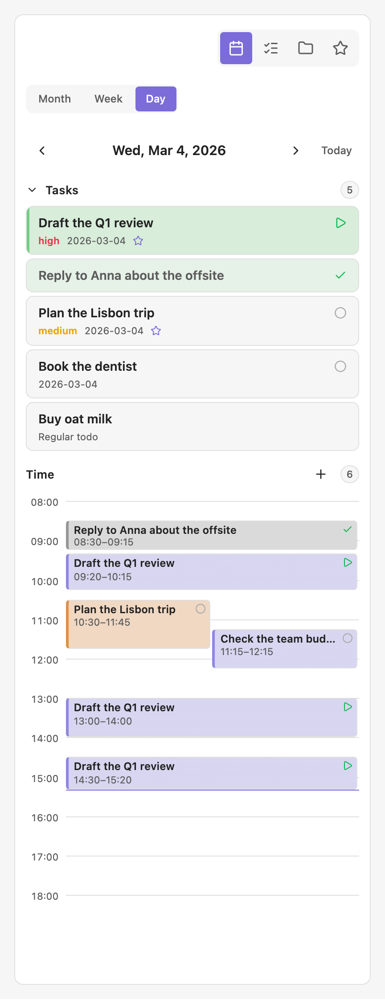
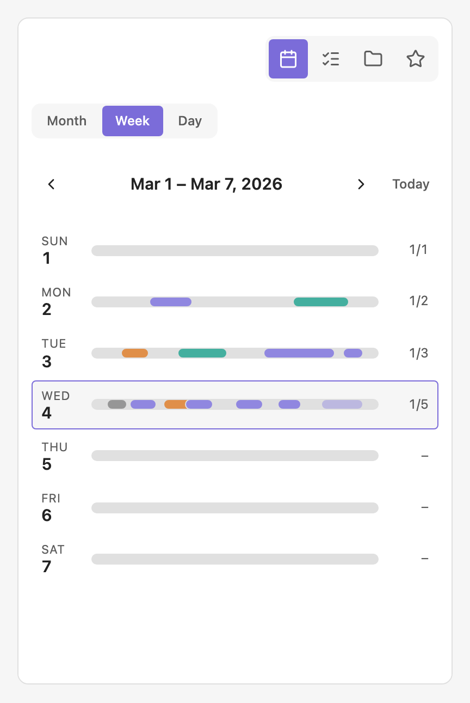
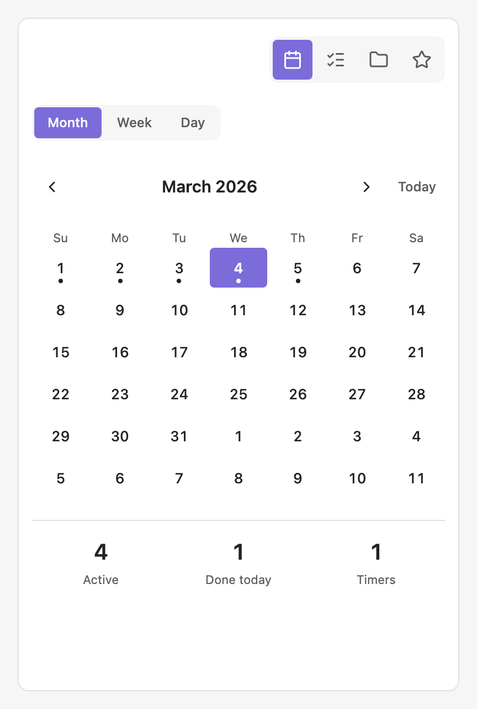
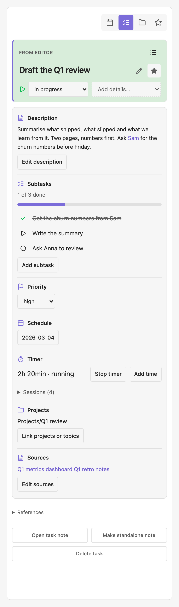
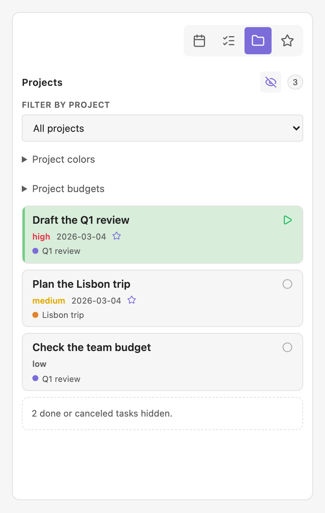
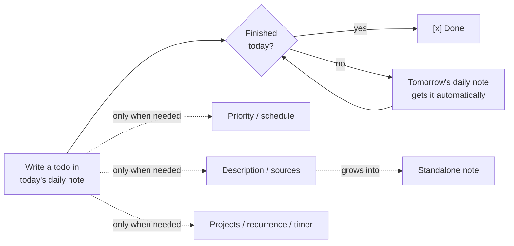
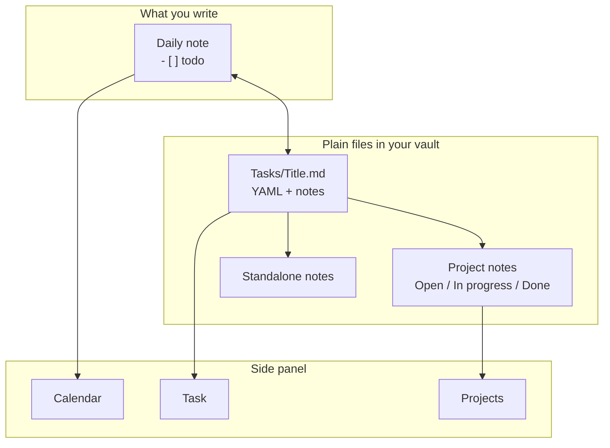

# Organized

**Your daily note stays your daily note. Organized gives its todos a memory.**

Many of us run our day from a daily note: a few checkboxes, some notes, done. That works until a todo needs more than a checkbox: it is unfinished and should show up again tomorrow, it matters more than the rest, it belongs to a project, it needs a deadline, a few notes, or a timer. Organized adds exactly that, without moving your work out of Markdown. No service, telemetry or proprietary task database.

## See it

The side panel, rendered from the plugin's own code and styles with sample data (light or dark, following your GitHub theme).

<table><tr><td align="center" valign="top"><picture><source media="(prefers-color-scheme: dark)" srcset="resources/screenshots/day-dark.png"></picture> Day</td><td align="center" valign="top"><picture><source media="(prefers-color-scheme: dark)" srcset="resources/screenshots/week-dark.png"></picture> Week</td><td align="center" valign="top"><picture><source media="(prefers-color-scheme: dark)" srcset="resources/screenshots/month-dark.png"></picture> Month</td></tr></table>

<table><tr><td align="center" valign="top"><picture><source media="(prefers-color-scheme: dark)" srcset="resources/screenshots/task-dark.png"></picture> Task</td><td align="center" valign="top"><picture><source media="(prefers-color-scheme: dark)" srcset="resources/screenshots/projects-dark.png"></picture> Projects</td></tr></table>

## Why use it

- **Unfinished work follows you.** Open today's daily note and yesterday's open todos are already there. Nothing is copied by hand and nothing silently disappears.
- **A todo can grow when it needs to.** Priority, a scheduled date, a description (write `[[Note]]` in it to link any note), sources, a recurrence, projects, tracked time: each one is added only when you ask for it.
- **It is still your Markdown.** A todo is a normal `- [ ]` line in a normal note. The details live in a plain note file, so search, links, sync and backups work as they always did.
- **Keyboard first.** Type a letter in the checkbox (`[!]`, `[<]`, `[/]` ...) and the todo does that. No menus required.

## Use as little or as much as you like

Organized does not ask you to adopt a system. Stay at the first level forever, or grow into the next one on the day you need it.

| Level | What you do | What you get |
|---|---|---|
| **1. Forwarder** | Write todos in your daily note as usual. Change nothing else. | Unfinished tasks carry over to the next day automatically; the old line is marked as forwarded so history stays honest. |
| **2. Organised** | Press `[!]` for priority, `[<]` to schedule for a date, `[*]` to favourite. | The daily note sorts by priority and keeps what you are working on at the top; scheduled tasks arrive on their day. |
| **3. Full workflow** | Add a description and sources, attach projects, repeat tasks, start a timer, turn a todo into a standalone note. | A calendar with the time you really spent, project pages with Open / In progress / Done, recurring routines, and notes that came from todos. |

## Simple on purpose

The Task view does not show every field a todo can hold. A task shows its title and status first. Everything else sits behind one **Add details** menu, and optional sections such as sources stay hidden until they hold something. The idea is that a todo should cost nothing until you decide it deserves more, so you only ever see what you chose to use. An empty form with twenty fields is how a todo list turns into chores.

## How it fits Obsidian

Obsidian's strength is that your notes are plain files you own. Organized is built to leave that intact.

- **Files over apps.** Every task is a Markdown note named after its todo (`Tasks/Write the Q1 report.md`) with standard YAML. Uninstall the plugin and you keep every task, readable in any editor.
- **Daily notes are the home base.** Organized works with your existing daily-note setup, folder, filename format and template. It does not replace them or hide them behind its own screen.
- **Links, not silos.** A todo can become a note, belong to project notes, and cite sources, all with ordinary wiki links and properties that Search, Graph, Bases and other plugins can use.
- **Local and quiet.** No account, no server, no tracking. It runs on desktop and mobile.
- **Composable.** Organized adds behaviour to the Markdown you already write; it does not ask you to leave it.

## First run

The first time Organized starts it shows a short **onboarding card**: ten steps with small illustrations: the two settings to make first, the idea behind the plugin, the side panel and calendar, showing task properties in the note, the checkbox letters, and how to start and leave. Skip it whenever you like; it appears once. Reopen it with the command **Organized: Show onboarding card** or the **Onboarding card** button in **Settings → Organized → Help**.

## Leaving Organized

Organized never locks your notes in. A task note already reads naturally without the plugin (properties, then the description as plain text, then your sources), and the only thing Organized adds to a todo is a hidden `<!--organized:...-->` comment. When you want to leave, or just tidy up finished tasks, run **Organized: Retire tasks…** (also under **Settings → Organized → Help**). It opens a window; nothing changes until you press **Retire**, the old text is saved under `note-backups` in the plugin folder first, and **Undo** restores the notes and their names. Run it on one device and let sync settle.

| Choice | Options |
|---|---|
| **Which tasks** | Only completed or canceled tasks older than N days (what the automatic cleanup does), or all tasks. |
| **Todos in your notes become** | A plain todo (title only), or a link to the task note (`- [ ] [[Plan release]]`, marker kept; the link style follows your Obsidian setting). |
| **Task notes** | Keep where they are, rename to the todo title (notes created by recent versions already carry it; only notes still named after an id are renamed), or move to Obsidian's trash. |
| **Properties of task notes** | Keep all, or remove Organized's properties and keep only the title (as the file name) and the text. Properties you added yourself (tags, aliases…) are never removed. |
| **Kept under the todo** | When a task note is removed or stripped, what stays in your daily note as a quote under the todo: nothing, the description, or description, sources and time worked. |

Combinations that cannot work are switched for you (removing properties needs the rename; a trashed note cannot be linked to) and a line at the bottom says exactly what will happen. Choosing the trash or removing properties asks once more; a run that trashes notes offers no Undo (restore them from Obsidian's trash). A task that cannot be retired (for example a note that changed while the window was open) is left exactly as it was and reported. **Convert tasks in this note back to todos** does the plain, keep-everything version for one note.

What the window never touches: project notes (their `organized_type`, `organized_start` and `organized_color` properties and the Open / In progress / Ongoing / Done headings) and lines such as `Worked 2026-03-02: 09:00–09:30` under a checkbox, and `[>]` or `[<]` markers. They are ordinary Markdown you can keep or delete.

## Try the beta

Use a **test vault**. In BRAT, add **`davadev/Organized`** and select the beta release. Alternatively download `main.js`, `manifest.json`, `styles.css` from the same GitHub release into `<test vault>/.obsidian/plugins/organized/`, then restart and enable Organized.

Open **Settings → Organized** and match **Daily-note folder** and **Filename format** to your daily-note setup. Core configuration is not read through undocumented APIs. Set **Daily-note template** to a note such as `Templates/Daily.md` so daily notes Organized creates (for example when scheduling to a new date) start from it; `{{date}}`, `{{date:FORMAT}}` and `{{title}}` are filled in. Task files default to `Tasks/` (visible Markdown, not a hidden `.tasks` directory).

**Auto-forward is on by default.** Opening today's daily note carries the latest unfinished non-recurring tasks forward, updates their schedule and marks prior occurrences forwarded; it does not create today's note on a timer. Recurring `[f]` occurrences are skipped because recurrence creates their next daily-note occurrence. Turn auto-forward off in settings if unwanted. A formatted batch summary offers Undo. **Show scheduled date link** controls date links globally and is on by default.

Open the ribbon calendar or run **Organized: Open inspector**. Its tabs, shown as icons at the top right, are Calendar, Task, Projects and Favorites (a star). Selecting a day in the month view explicitly opens/creates its daily note. The **Week** and **Day** views show tasks and the time they were In Progress (recorded from the moment you update); they never create notes. Merely browsing months creates nothing. Time worked can be added or corrected by hand: the **+** beside the Day view's Time heading, a tap on a block, or the Task tab's Timer card, whose foldable Sessions list shows every session newest first by day.

Task notes written by older betas were named after an id; one automatic step, once after updating, renames them after their todo (a backup of the plan is saved in the plugin folder and the notice has Undo). Update Organized on all your devices at the same time, because an older version looks for task notes by their id. The command **Rename task notes to their titles** runs it again.

The Task tab keeps your selection while you scroll or edit the sidebar. When the cursor is not on a task, it lists task lines from the current note; tap a linked task to jump the editor cursor there and show its details. Optional cards show populated details or the section you request with a shortcut or **Add details…**; history and references are collapsed. Editing the title or any task note section happens inline in the sidebar, with Save and Cancel above the field so the mobile keyboard cannot cover them. **Description** is the text of the task note itself, so write `[[Note]]` in it to link any note; it shows as a clickable link when you are not editing. **Sources** (external links and `[[notes]]`) sit below it. Task notes from older versions (with `## Description`, `## Notes`, `## Idea` headings) are rewritten once after updating, with a backup and an Undo button, so the description becomes the plain text of the note. The Projects tab is grouped into Favorites, Projects and Canceled cards with a project filter and counts. Use **Delete task** on the Task tab to confirm removal of the canonical note and all linked occurrences. Fully restart Obsidian after updating to refresh the setting groups.

## Link or create tasks

Typing a new `- [ ] ` or inserting one with Obsidian's mobile checkbox toolbar opens the native task picker. Choose an existing unfinished task (completed and canceled ones are not listed), **Create new task**, or **Keep as regular todo**. The last option closes the picker and leaves an ordinary unlinked checkbox. Pasted task blocks are not converted automatically. Use **Attach/create task** on an existing checkbox; **Duplicate as new task** creates an independent ID. Missing links are never silently replaced. Markdown links in task titles and task-note sections open from the picker and inspector; title editing keeps the raw Markdown syntax.

Run **Organized: Convert unchecked todos to tasks** on a regular note to convert its ordinary unchecked todos into canonical tasks. It confirms first, skips linked, completed, in-progress and empty items, and preserves indentation and line endings. To leave Organized, see [Leaving Organized](#leaving-organized): **Organized: Retire tasks…** turns tasks back into ordinary Markdown with options, and **Convert tasks in this note back to todos** does the simple version for one note.

Each canonical task is a note in `Tasks/` named after its todo (`Write the Q1 report.md`; a counter is added when a name is taken, and names are unique across the vault so `[[links]]` stay unambiguous), identified by the `id` in its properties, never by its file name, so renaming the note by hand is safe. It has its properties in standard YAML and the description as the note text, followed by an optional `## Sources` heading, so the note reads naturally even without the plugin. Occurrences contain `<!--organized:<id>-->`. A copied ID remains the same task. Selected properties render read-only in Reading/Live Preview; no generated dates/properties are written into occurrence source. The inspector edits the canonical note.

**Subtasks.** Indent a linked todo under another todo (Tab, as in any Obsidian list) and it becomes that todo's subtask: the same picker asks which task it is, and the parent's task note lists it in its properties as a link (`subtasks: ["[[Buy milk]]"]`), so the relation reads naturally even without the plugin. The nesting in the note is the truth: indenting, outdenting, moving or deleting a todo line updates the lists a moment after you stop typing, and **Organized: Repair subtask links in this note** redoes it for a note edited somewhere Organized was not running. **Organized: Add subtask** inserts an empty indented todo under the one at the cursor. Turn on **Subtask progress** under Rendered task properties to see `2/3` beside a parent (gray at none, accent partway, green when all are done; canceled subtasks are not counted); the Task tab shows a **Subtasks** card with the same progress, a toggle per subtask, **Add subtask**, and a *Part of* link from a subtask back to its parent. Sorting keeps subtasks among their own siblings. Recurring tasks cannot be parents or subtasks. A todo nested under a plain todo, or typed as **Keep as regular todo**, is not a subtask.

In **Settings → Task storage**, **Keep completed tasks (days)** optionally sets retention from the date a task is completed or canceled. It defaults to `0` (disabled). When enabled, cleanup runs while opening today's daily note: linked checkboxes are unlinked and the canonical task files move to Obsidian's trash. Open/in-progress, recurring, and legacy completed tasks without a recorded completion date are preserved. Keep a vault backup and confirm Obsidian's trash preference before enabling automatic cleanup.

**What retired tasks keep** chooses what the checkbox leaves behind: *the title only* (default), *add description* (the description as a quote under the checkbox) or *add everything* (also sources, plus one line per day of time worked, such as `- Worked 2026-03-02: 09:00–09:30, 10:00–10:20 (50 min)`). It is written under the latest daily note only and reads as ordinary nested list items. The Day and Week views read those `Worked` lines back, so time blocks of retired tasks stay on the calendar; only the daily notes of the viewed days and the following month are read, and each is read once until it changes.

**Rendered properties are compact symbols** (Settings → Organized → Rendered task properties, where *Alignment* puts them right after the text or at the right edge of the line), each with a screen-reader label: a yellow star when starred (gray when not), a green repeat sign when recurring (gray when not), a flag coloured by priority, a status icon, a timer with the time (`45 min`, `1h 13min`; green while running), the created date and the number of moves. Project links show the project name only, in the project's colour, and open the project note. With sorting on, open todos come first (in-progress on top, then by priority, none included), followed by done, canceled, forwarded and scheduled ones; a plain bullet between todos (such as the link a todo leaves after becoming a note) does not split the list.

Identity and recurrence comments stay hidden in Live Preview, including the line being edited. Switch to source mode to inspect the original Markdown.

| Marker | Action |
|---|---|
| `[<]` | Choose schedule date; keep origin marker, link daily destination |
| `[>]` | Forward to tomorrow; daily origin stays gray, undated origin stays active |
| `[/]` | Start durable wall-clock timer; complete or clear to stop/log. Changing the `/` to anything else, or deleting the line, stops the timer too and a notice says so |
| `[!]` | High/medium/low/none priority, constrained sort, then clear |
| `[a]` | Open the Description section for inline editing (autosaves), then clear |
| `[x]`, `[ ]` | Complete/reopen; stop active timer idempotently |
| `[-]` | Reversible cancellation; recurring dates cancel independently |
| `[*]` | Toggle favorite |
| `[s]` | Open the Sources section for inline Markdown references (URLs/Obsidian links, optional labels/citations) |
| `[j]` | Multi-select project notes; missing selected notes are created in `<task folder>/Projects/` with `organized_type: project` and an `organized_start` date in their frontmatter and **Open / In progress / Ongoing / Done** headings that linked tasks move between as their status changes, and only such notes are listed. A project can have a colour (`organized_color: "#rrggbb"`, set from the Projects tab) shown as a dot beside its name on task cards and as the fill of its blocks in the calendar |
| `[n]` | Make a standalone note: asks for a folder, optional tags and an optional template, creates a note titled after the todo holding its description (then sources), and replaces the todo with a link to it. If a note of that name exists you can number the new one or link the existing one. The task's other copies are removed and its task note moves to Obsidian's trash. Also on the Task tab as **Make standalone note** Tracked time is kept: a running timer is logged, and a task with tracked sessions keeps a hidden task note so the calendar still shows (and links to) its time. |
| `[r]` | Toggle recurrence in existing/current/future and subsequently created daily notes; clear after success |

Only the markers above act. Every other character, including the old action letters `[i]`, `[I]`, `[?]`, `["]`, `[b]` and `[f]` and the theme glyphs `[d]`, `[p]`, `[k]`, `[l]`, `[S]`, `[c]`, `[w]`, `[u]`, `[D]`, `[P]`, `[M]`, is **formatting only**: it shows its icon and never changes metadata or storage. Use them freely to style a todo without side effects. Things-style glyphs are bundled, so the Things theme is not required.

Historical daily checkboxes remain historical. Non-recurring status changes propagate to today/future daily notes and undated/project references, not prior days. Recurring dates are independent; disabling recurrence removes only uniquely identified generated future copies. Multiple tasks may have running timers; no background writes or ticking process is required.

See [documentation](docs/index.md), [safety/architecture](docs/architecture.md), [testing](docs/testing.md), [release manual](docs/releasing.md) and [third-party licenses](THIRD_PARTY_NOTICES.md). MIT; project by **davadev**. Calendar Plus is the calendar design reference; Things/Minimal and credited upstream MIT icon projects supply the checkbox artwork.
